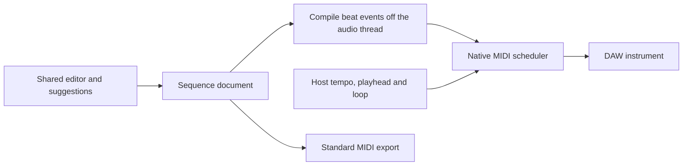

# DAW integration

chord.sh develops harmony and outputs MIDI; the DAW supplies the instrument sound. The current build
provides the browser editor, MIDI files and Web MIDI output. Native plug-in binaries are a planned
delivery format, not an existing feature.

## Use your DAW's instruments now

1. Create or enable a virtual MIDI connection that both your browser and DAW can see. On macOS this can
   be an IAC bus; Windows needs a virtual MIDI port; Linux needs a sequencer port exposed to the browser.
   [Ableton's virtual MIDI guide](https://help.ableton.com/hc/en-us/articles/209774225-Setting-up-a-virtual-MIDI-bus)
   describes the application-to-application approach and macOS/Windows setup.
2. In chord.sh, choose **Settings → MIDI output** and select that connection. Set **Playback output** to
   **DAW / MIDI out**. This also turns off browser monitoring.
3. Put an instrument on a DAW MIDI track, select the virtual connection as its input, and enable
   monitoring. Play the sequence or preview a suggestion in chord.sh.
4. Use Stop or Escape to cancel queued notes and release sustain. Record the incoming MIDI in the DAW
   when you want to commit a performance there.

Sequences, library performances, suggestions, and the computer/on-screen keyboard all use this output.
Incoming hardware MIDI is analysed without being echoed back to the output, preventing a virtual-port
feedback loop. For a physical keyboard, let the DAW monitor that keyboard directly as well. Browser MIDI timing is scheduled
against the browser clock; it does not currently follow the DAW's transport, tempo changes or loop.
Web MIDI availability and device permissions depend on the browser and OS.

For file interchange, use **Export MIDI** (⇩) for the current song/performance and drop the `.mid` file
into an instrument track. Export is Standard MIDI File format 0 at 480 ticks per quarter note, with
tempo, quarter-note meter, notes, durations, velocities and sustain. Gaps and voicings are retained.
There is one output channel and one tempo/meter; arbitrary controllers, original track structure and
changing tempo maps are not preserved.

## Native plug-in direction

The shared core should remain independent of the DAW and OS, with a separately built host wrapper for
each supported format/platform. No single binary or plug-in format covers every DAW.

| format     | purpose                                                         | platform direction                |
| ---------- | --------------------------------------------------------------- | --------------------------------- |
| VST3       | broad desktop hosting and generated MIDI routing                | Windows, macOS and Linux builds   |
| AU MIDI FX | Logic's MIDI-processor slot before an instrument                | macOS build                       |
| CLAP       | additional hosts that support its MIDI/note and transport model | optional desktop builds           |
| AAX        | Pro Tools support if included in the supported-host matrix      | separate AAX build and validation |

The [VST3 SDK](https://github.com/steinbergmedia/vst3sdk) documents its desktop platforms.
[JUCE's MIDI plug-in examples](https://juce.com/tutorials/tutorial_plugin_examples/) provide an
implementation starting point, and its [build API](https://github.com/juce-framework/JUCE/blob/master/docs/CMake%20API.md)
supports selecting formats and MIDI-processor characteristics. [CLAP](https://github.com/free-audio/clap)
and [Avid's AAX SDK](https://developer.avid.com/aax/) are separate host APIs.

Host routing must be tested rather than inferred from format support. For example,
[Ableton routes VST-generated MIDI to another track](https://help.ableton.com/hc/en-us/articles/209070189-Accessing-the-MIDI-output-of-a-VST-plug-in)
and documents that its AU route does not expose MIDI output. Logic has a dedicated MIDI plug-in chain
before the instrument ([Apple's effects guide](https://help.apple.com/pdf/logicpromac-effects/en_US/logic-pro-mac-effects-user-guide.pdf)).

### Proposed architecture

`Sequence` already stores beat positions, durations, notes, velocities and key regions as serializable
data. Keep chord theory, editing and inference in that shared core. A native UI bridge can submit a new
sequence snapshot; an off-thread compiler can produce immutable note/control events. The native audio
callback should only read that schedule and translate host musical time to sample offsets, including
tempo changes, seeks, loops and note-offs. JavaScript execution, file access and UI messages should stay
off the audio thread.

The remaining native work is the wrapper/bridge, host-state save/restore, transport synchronization,
per-platform builds and a tested host matrix. Browser MIDI routing is useful immediately but is not a
substitute for sample-accurate native hosting.
